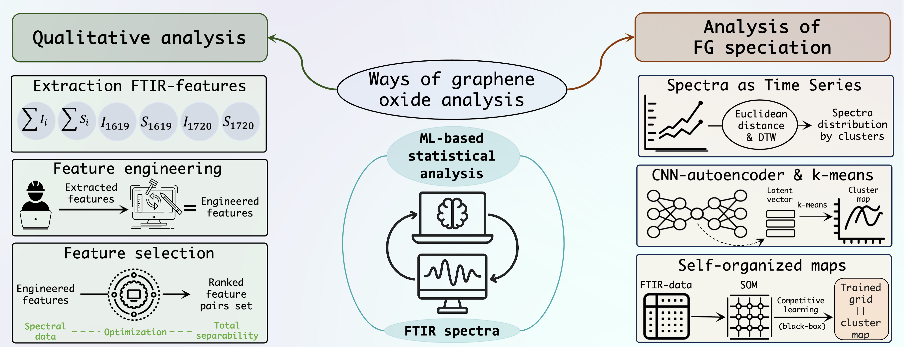

# Machine Learning‑Guided ATR‑FTIR for In‑Depth Analysis of Graphene Oxide Dispersions

## Abstract

The variation of graphene oxide preparation techniques and the often occurring similarity of spectral information in molecular spectroscopy data for tested samples pose challenges for reliable data interpretation, especially when conservative “manual” analysis methods are used. This work employs a machine learning (ML)–based approach to develop an algorithm to solve cluster analysis issues of the infrared spectroscopy data for the graphene oxide: as–prepared, purified (by dialysis bag), and reduced samples. We propose an ML–based model to provide fully–automated qualitative analysis and a semi–automated pipeline for functional groups speciation analysis on graphene oxide, developed by simultaneously combining statistical analysis and data processing, optimization algorithms, and applying unsupervised learning techniques. Also, the study examines the possibilities of applying ML to analyze and cluster data from UV/vis and Dynamic Light Scattering (DLS).

## Graphical abstract



## Code and analysis notebooks

Python notebooks accompanying the article on graphene oxide dispersions. The repository combines qualitative analysis of ATR–FTIR, UV/vis and dynamic light scattering measurements with analysis of functional-group distributions using spectral clustering, autoencoders and self-organising maps.

## Repository structure

- `qualitative_analysis/ftir/`: spectral preprocessing, visualisation, feature analysis, clustering and classification.
- `qualitative_analysis/uv_vis/`: UV/vis preprocessing and visualisation.
- `qualitative_analysis/dls/`: descriptive statistics, feature engineering and clustering of colloidal parameters.
- `fg_distribution_analysis/`: spectral clustering, autoencoder and self-organising-map analyses.
- `assets/`: graphical abstract.
- `requirements.txt`: recorded Python environment.

Each analysis branch contains its own `data/`, `notebooks/` and `results/` directories.

## Notebook guide

Run numbered preprocessing and feature-preparation notebooks before the analyses that consume their outputs. The three functional-group distribution notebooks implement alternative approaches. Archived copies under `old_versions/` are excluded from this guide.

### ATR–FTIR qualitative analysis

| Notebook | Purpose |
| --- | --- |
| [01_data_preprocessing](qualitative_analysis/ftir/notebooks/01_data_preprocessing.ipynb) | Preprocess measurements. |
| [02a_visualization](qualitative_analysis/ftir/notebooks/02a_visualization.ipynb) | Visualise ATR–FTIR spectra. |
| [02b_derivatives_analysis](qualitative_analysis/ftir/notebooks/02b_derivatives_analysis.ipynb) | Analyse spectral derivatives. |
| [02c_dimensionality_reduction](qualitative_analysis/ftir/notebooks/02c_dimensionality_reduction.ipynb) | Explore reduced spectral representations. |
| [02d_visualization_sulfate](qualitative_analysis/ftir/notebooks/02d_visualization_sulfate.ipynb) | Visualise sulfate reference spectra. |
| [03a_spectral_features_extraction_engineering](qualitative_analysis/ftir/notebooks/03a_spectral_features_extraction_engineering.ipynb) | Extract and engineer spectral features. |
| [03b_spectral_features_clustering](qualitative_analysis/ftir/notebooks/03b_spectral_features_clustering.ipynb) | Cluster spectral descriptors. |
| [03c_spectral_features_modeling_lr](qualitative_analysis/ftir/notebooks/03c_spectral_features_modeling_lr.ipynb) | Logistic regression on spectral descriptors. |
| [03d_spectral_features_svm](qualitative_analysis/ftir/notebooks/03d_spectral_features_svm.ipynb) | Support vector machine analysis. |

### UV/vis analysis

| Notebook | Purpose |
| --- | --- |
| [01_data_preprocessing](qualitative_analysis/uv_vis/notebooks/01_data_preprocessing.ipynb) | Preprocess measurements. |
| [02_visualization](qualitative_analysis/uv_vis/notebooks/02_visualization.ipynb) | Visualise UV/vis spectra. |

### Colloidal parameters

| Notebook | Purpose |
| --- | --- |
| [01_descriptive_statistics](qualitative_analysis/dls/notebooks/01_descriptive_statistics.ipynb) | Describe colloidal parameters. |
| [02_feature_engineering](qualitative_analysis/dls/notebooks/02_feature_engineering.ipynb) | Prepare colloidal descriptors. |
| [03_cp_clustering](qualitative_analysis/dls/notebooks/03_cp_clustering.ipynb) | Cluster colloidal parameters. |

### Functional-group distribution analysis

| Notebook | Purpose |
| --- | --- |
| [01a_clustering_spectra_as_timeseries](fg_distribution_analysis/notebooks/01a_clustering_spectra_as_timeseries.ipynb) | Cluster spectra using Euclidean distance and dynamic time warping. |
| [01b_clustering_autoencoder](fg_distribution_analysis/notebooks/01b_clustering_autoencoder.ipynb) | Learn autoencoder representations for clustering. |
| [01c_clustering_minisom](fg_distribution_analysis/notebooks/01c_clustering_minisom.ipynb) | Analyse spectra with self-organising maps. |

## Environment and execution

Create a Python environment from the repository root:

```bash
python3 -m venv .venv
source .venv/bin/activate
python -m pip install -r requirements.txt
```

`requirements.txt` records the development environment, including platform-specific or local packages; installation in a fresh environment has not been verified. Adjust unavailable packages for the target platform if needed.

Open notebooks in a Jupyter-compatible editor using that environment. Start each notebook from its own `notebooks/` directory: relative paths such as `../data/` and `../results/` are resolved from the working directory. Check input paths and parameters, then execute cells from top to bottom. Rerunning notebooks can overwrite derived files.

## Data and outputs

The repository includes versioned input and intermediate data. Each notebook defines the files it reads and writes; check those paths before rerunning an analysis. Saved figures and notebook outputs support inspection of the reported workflow.

## Licence

Code is released under the [MIT licence](LICENSE).
